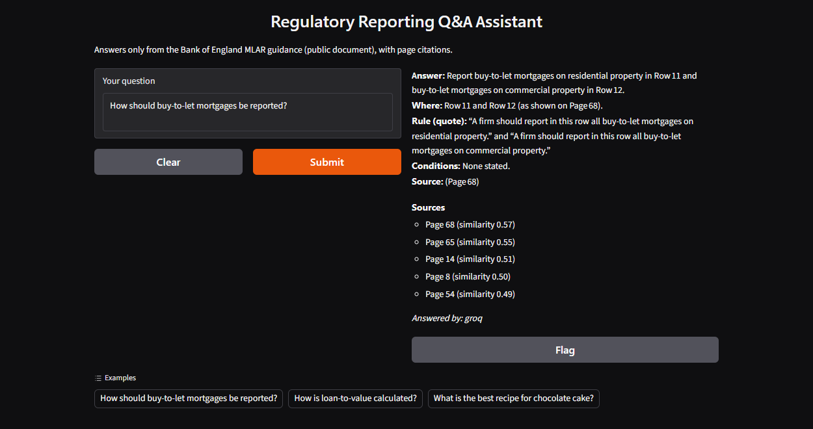
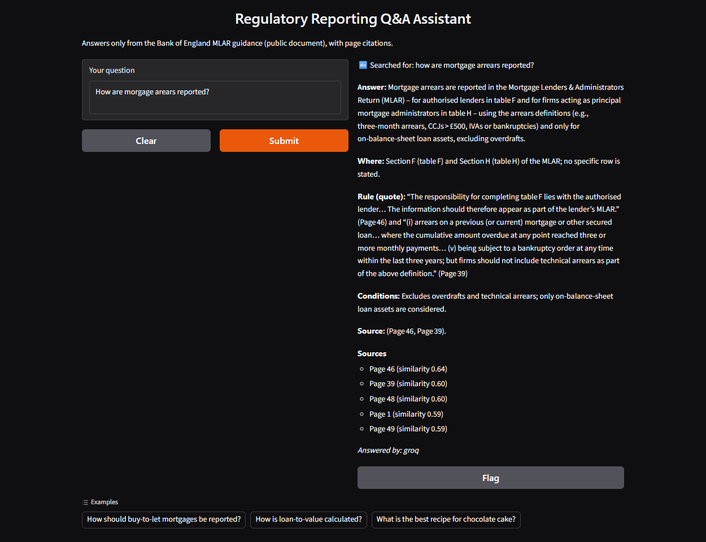
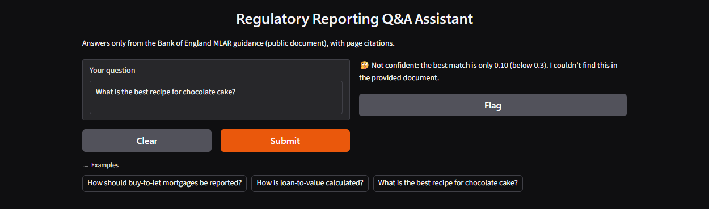

# Regulatory Reporting Q&A Assistant (RAG)

Ask a question about the Bank of England **MLAR** reporting guidance and get a short answer that quotes the rule and cites the page, or an honest "I couldn't find this".

> Public document only: [BoE MLAR guidance notes (Jan 2022)](https://www.bankofengland.co.uk/-/media/boe/files/prudential-regulation/crd-iv/mlar-notes-jan-2022.pdf). No bank, customer or client data is used.

## Screenshots
**A grounded answer in the fixed layout, with page sources**



**A typo corrected using the document's own words**



**An off-topic question blocked by the confidence threshold (the LLM is not called)**



## The problem
Reporting analysts and BAs spend hours searching long regulatory PDFs to find which row a product goes in and under what conditions. General chatbots answer from memory and can invent rules.

## How it works
```
Question
  → spelling fix (only to words found in the PDF)
  → hybrid search: meaning score (MiniLM embeddings) + keyword bonus → top 8 chunks
  → confidence threshold (0.30): if nothing passes, say "not confident" and do NOT call the LLM
  → LLM (Groq, temperature 0) answers ONLY from those chunks, in a fixed layout
  → page sources and similarity scores shown with the answer
```

**Answer layout:** Answer · Where (form/row) · Rule (exact quote) · Conditions · Source (pages)

## Results
A 10-question test set (6 answerable, 4 not in the document), re-run after every change:

| Run | Change | Score |
|---|---|---|
| 1 | Baseline, threshold 0.40 | 8/10 |
| 2 | Threshold lowered to 0.30 (jargon questions scored ~0.35) | 8/10 |
| 3 | Temperature 0 (answers flip-flopped between runs) | 9/10 |
| 4 | Hybrid keyword bonus (fixed "possessions" retrieval miss) | 9/10, LTV page pushed out |
| 5 | top_k 5 → 8 (regression fixed) | **10/10** |
| 6 | Gradio screen, spelling fix, fixed answer layout | **10/10** |

## Guardrails
- Grounding: the LLM may use only the retrieved passages and must cite pages.
- Confidence threshold blocks weak matches before the LLM is called.
- Temperature 0 for repeatable answers.
- API keys are kept in environment secrets, never in code.

## Run it
```bash
pip install -r requirements.txt
export GROQ_API_KEY=...        # free key from console.groq.com
python app.py                  # opens the web screen
python evaluate_qa.py          # runs the 10 tests
```

**Live demo:** run it in Google Colab with `demo.launch(share=True)`. Gradio gives a temporary public link (72 hours) at no hosting cost, and the API key stays in Colab Secrets.

## Next
Section metadata for scope control, a persistent vector store (Pinecone), and reranking (Cohere) for precision.
